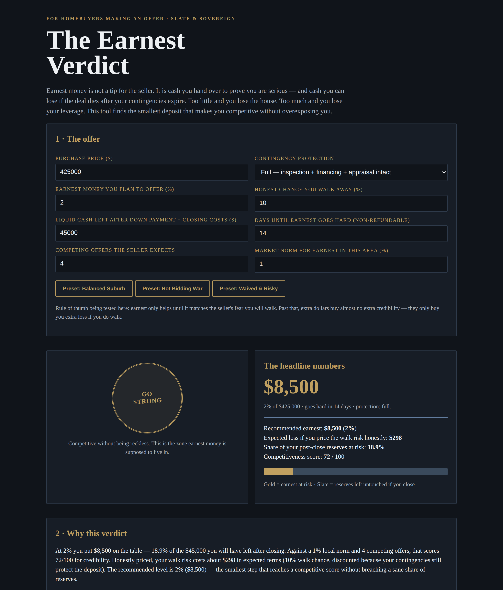

# The Earnest Verdict — How Much Earnest Money Is Enough?

**Live:** https://thebullbrew.github.io/earnest-verdict/
**Repo:** https://github.com/thebullbrew/earnest-verdict

## What it does

Prices earnest money honestly for homebuyers making an offer: the deposit you plan to offer scored for competitiveness against the local norm and the competing-offer field, priced for risk against the liquid cash you will still have after closing, and adjusted for how much contingency protection you actually hold. You get a GO LEAN / GO STANDARD / GO STRONG / OVEREXPOSED seal, a recommended earnest level — the smallest step that reaches a competitive score without breaching a sane share of reserves — an expected-loss figure, and a 0.5–5% sensitivity table. Includes 3 presets, saveable cases, and a copyable summary. On the defaults it lands at GO STRONG, $8,500 on a $425,000 house.

## The method

Competitiveness is scored against the local norm: matching it scores about 50, each full point above it adds credibility up to a cap, and a crowded field raises the bar. Risk is priced two ways — the dollars themselves, and what share of post-close reserves they consume, because a $10,000 deposit means something very different with $60,000 left than with $15,000 left. Expected loss = earnest × walk-away chance, discounted when contingencies still protect the deposit (full protection), partly discounted for partial protection, and undiscounted when contingencies are waived and the money goes hard fast. The recommended level is solved by scanning 0.25% steps for the first level that reaches a competitiveness score of 70, capped by reserve safety when protection is not full. Earnest and forfeiture rules vary by state and contract — read your actual offer. General information, not legal advice.

## Design

Dark aesthetic variation 10 — Slate & Sovereign: cool slate-blue and steel-gold on near-black, sharp 2px corners, precise grid lines, tabular numerals — a trading desk in a mahogany-paneled room.

## How to run

Open `docs/index.html` in any browser, or serve `docs/` with any static host. Works offline as a PWA after first load. No backend, no accounts, no data leaves your device — saved cases live in localStorage.
